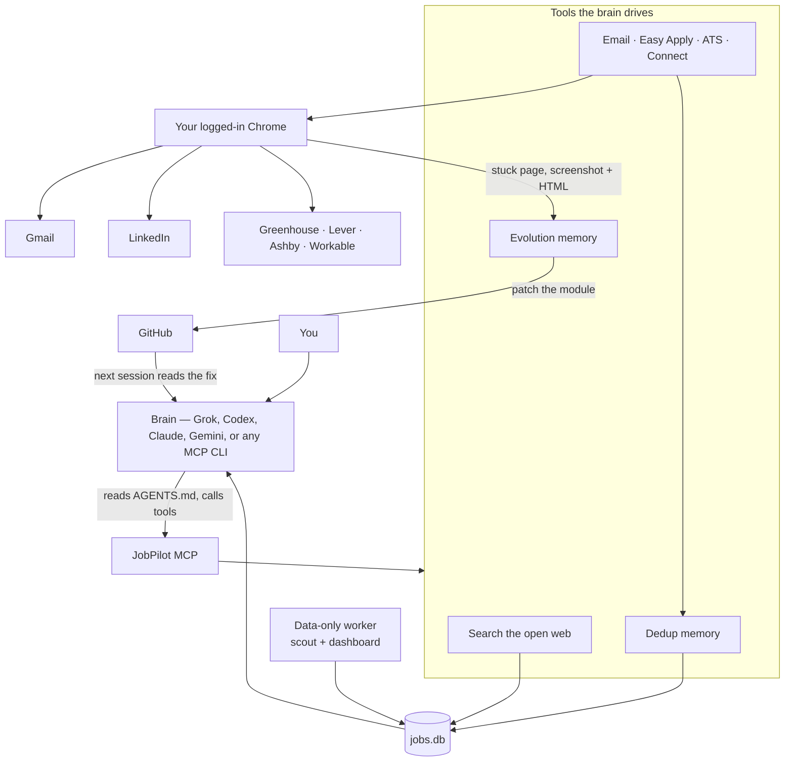
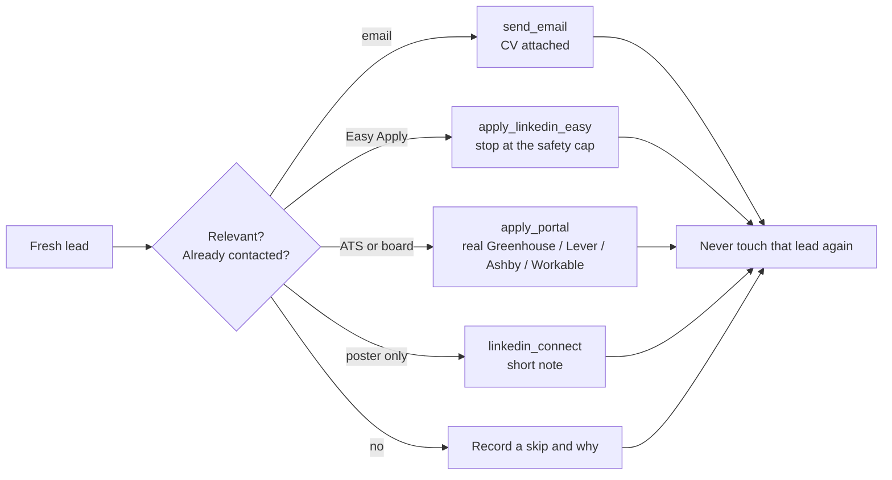
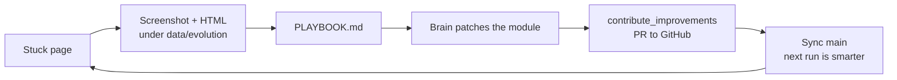
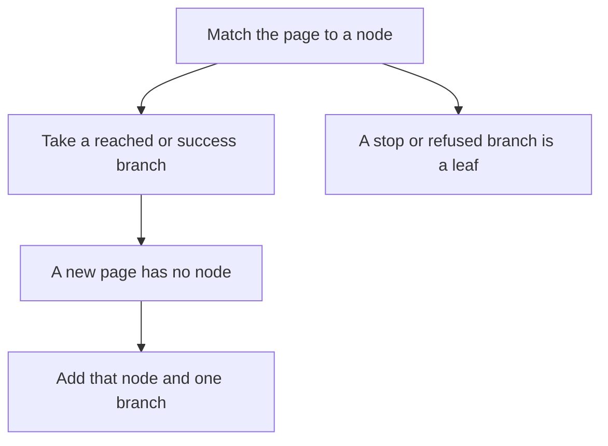
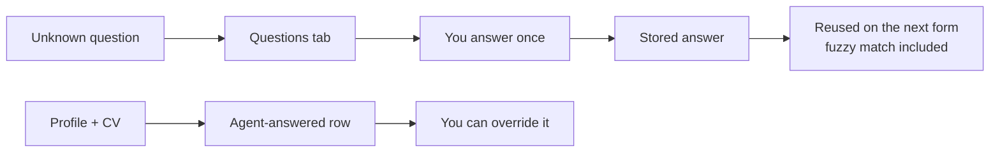

<div align="center">

# JobPilot

### One brain. Eight doors. A hunt that learns the lock.

You point a coding agent at this folder. That agent is the brain. JobPilot is the body: your browser, a memory that never asks twice, and a loop that turns a stuck page into a fix on GitHub. There is no model hiding in here.

<p align="center">


</p>

The first minutes are quiet on purpose. Dependencies install themselves. Leave that window open. The browser opens once, on first onboard, and you sign in on every platform above. After that, those sessions stay.

**Stable release: [v3.6.0](https://github.com/maazbin/jobpilot/releases/tag/v3.6.0).** Y Combinator and Wellfound are in the hunt. An open role is emailed to a published founder address. The Apply button is not the whole path.

[](https://github.com/maazbin/jobpilot/releases/tag/v3.6.0)
[](LICENSE)
[](https://modelcontextprotocol.io)
[](https://nodejs.org)


<sub>Full-quality demo: [`docs/demo.mp4`](docs/demo.mp4)</sub>

</div>

---

## The shape of it

One brain. It never starts a second brain. The worker only collects leads. Every email, Easy Apply,
portal application, and connection request is a decision the brain makes, then a tool it calls.



A single lead moves like this. The brain picks the channel. The tool does one concrete action.



When a page wins, the system does not drop the lead and forget. It keeps the evidence and the fix comes back as code.



---

## What the brain does, and what the tools do

| | Brain (your CLI) | JobPilot |
|---|---|---|
| Decides | Which roles, which country, which channel, what the email says, when to stop | Nothing. No LLM lives here. |
| Acts | Calls one tool per action | Drives your Chrome, sends the mail, fills the form, writes the row |
| Remembers | Reads the bank and the playbook | `data/jobs.db` dedups email, apply, and connect across runs and across agents |
| Improves | Patches the module that failed | Saves the encounter, opens the PR, refuses to commit `data/` or credentials |

No API keys. No SMTP. Sessions stay in your browser. Personal data stays in `data/`, which git ignores.

---

## Four channels

Newest posts first. The brain chooses. Tools do not pick a channel on their own.

| Channel | Tool | What “done” means |
|---|---|---|
| Email | `send_email` | Sent from your Gmail. CV attached. Portfolio and links come from the profile. A JobPilot repo line is added only when that user saved `links.jobpilot`. |
| LinkedIn Easy Apply | `apply_linkedin_easy` | Modal walked, questions answered, “Application submitted” seen. |
| External form | `apply_portal` | Job-board URL resolved to the real ATS, then submitted. |
| Connect | `linkedin_connect` | A short note to the poster when there is no email and no form. |

Email is uncapped because it is your Gmail. The brain paces it. Easy Apply is capped: JobPilot refreshes the public daily limit, stops at 80% (default 50/day, so stop at 40), and waits a random 90–240s between submissions. A failed lookup never raises the cap.

---

## v3.0.0 — what this stable line solved

This is the line we will keep. New work happens after this tag.

**The architecture**

- The worker is data-only when you run `npm run agent`. It scrapes into `data/jobs.db` and refreshes the dashboard. It does not email, apply, or connect.
- One brain never starts another. There is no dispatcher that launches Codex, Grok, Claude, or Gemini.
- `AGENTS.md` is the only operating guide. Any MCP coding agent can drive the same tools.

**Outreach that used to fail quietly**

- Known-fake hiring addresses live in [`src/fake-emails.txt`](src/fake-emails.txt), one address per line. Send refuses that list. Adding a decoy is a file edit, not a new regular expression.
- Titles that match the profile (backend, Python, AI, platform, and the rest of the role list) stay in the email bank. They are no longer dropped as “not the CV.”
- An answer you type in the Questions tab survives when the worker saves the database. The newer answer wins, so a second process cannot put the question back.
- Salary questions can convert the profile currency into SAR and QAR, and current pay stays separate from the expected range.
- Lever’s real control is `Submit application`. The hidden hCaptcha button is no longer treated as the submit button. A live captcha can still stop the submit. That is an open problem, not a solved one.
- Phone-country widgets and cookie bars are closed before an external form is submitted.
- Easy Apply treats an intercepted LinkedIn click as a throttle and backs off, instead of hammering the page.
- Each job can select a private CV variant from `preferences.cvVariants`. The canonical CV stays the fallback. Resumes never go in git.
- Search uses only the places and roles on the profile. An empty profile does not search. Relocation and visa sponsorship are used when that profile asks for them. Country scope blocks outreach outside the profile country.

**The loop around the code**

- `contribute_improvements` syncs, files blockers, and opens or reviews PRs. Forks track upstream. The main repo reviews useful PRs from any author.
- The CI security gate blocks `data/`, credentials, and secrets. The syntax check skips files a PR deleted, so a deletion does not fail the build.
- Commits from the evolver are authored as the GitHub username, not a personal name or a personal email.

---

## v3.6.0

Y Combinator jobs open on Work at a Startup once the session exists. The public jobs page still shows Sign in. Founder names are on the company card. The letter goes to a founder address published on the company site or a sponsor page, with the CV. A role stays when it is remote with no country list, or it offers visa or relocation in a place on the profile. A US office is left, even when the card says Remote and Will sponsor.

Wellfound starts on the signed-in jobs page. A search that hides roles outside one city is not the senior list. The about form saves the GitHub URL, the portfolio, the bio, and years. A skill is the suggestion that starts with the skill name.

The dashboard mix has a slider for Y Combinator and a slider for Wellfound. Both start at 0 until you give them a share. The path traces are [`docs/paths/ycombinator/path.md`](docs/paths/ycombinator/path.md) and [`docs/paths/wellfound/path.md`](docs/paths/wellfound/path.md). One Berlin role with visa sponsorship was emailed to the published founder address. Gmail reported the CV sent.

## v3.5.0

X hiring posts are scraped when the mix gives X a share. The path trace follows an apply link on the post to the employer form. An Ashby page that only says the company is interested is not recorded as a submitted application.

The Strategies tab records what worked and what failed on each platform. A human verdict of wrong blocks that step. Instagram is read from the comments and the bio before a message is sent.

The first run says when dependencies are installing. Sign-in is requested once. When a site login fails, Google sign-in is tried once, and a second failure puts that site on the dashboard sign-in panel.

Easy Apply waits out a stuck review step, accepts a consent widget, and waits for the next step to render. The LinkedIn invite note is taken from the dialog that is actually visible. Login-page chrome is not stored as an unanswered application question. Indeed applystart is followed until the browser leaves Indeed. A role that requires US citizenship or US work authorization is skipped when the profile is not authorized in the United States. A salary answer keeps the currency stored on the profile. Country and phone are filled from the profile.

## v3.4.0

The setup page and the dashboard have **Test sign-in**. It opens X, LinkedIn, and Gmail in the debug Chrome and reports which of those sessions are signed in. An open tab whose address contains `x.com` is not treated as proof. The CV drop zone on the setup page keeps its script alive, and a click there opens the file dialog once.

Search and outreach still wait until the profile form has a name, an email, a CV, a LinkedIn URL, target roles, and the sites you are signed into.

## v3.3.0

A lead stays when the role is remote and not limited to a country list. Timezone overlap is enough. An on-site or hybrid role stays only when the post offers visa sponsorship or relocation in a place on the profile. The dashboard switch for this is on unless the profile turns it off.

Debug Chrome starts with Memory Saver and occluded-window throttling off, so a discarded tab does not stall the CDP handshake. A fresh clone finishes onboarding before any search. The dashboard mix sets how a cycle splits across sources and across email, posts, connect, DM, Easy Apply, and forms. On X, an apply link on the post is the application. A public reply is only for a post that has no apply link and no email. An application letter includes the JobPilot repository URL only when that profile saved the link.

Indeed **Apply now** works in the normal signed-in window, with the debug port closed. Three in-site applications reached the page that says the application was submitted. The jobs home is `https://pk.indeed.com/`. A `from=` tracking parameter is not part of that page. Typing `viewjob?jk=` into the address bar stops on Additional Verification. Leave that page. Do not click the check. Glassdoor job pages load after Google sign-in, and in-site Apply now there has still not been submitted. Issue [#1](https://github.com/maazbin/jobpilot/issues/1) is closed. Issue [#2](https://github.com/maazbin/jobpilot/issues/2) stays open for a driven Glassdoor browser.

### Path traces

Every agent reads the decision tree in [`docs/paths/`](docs/paths/) before it drives a site, then updates that tree. `AGENTS.md` makes this mandatory for every brain. One directory per site. A `node` is a page. A `branch` is one choice: the control, the next node, and `reached`, `success`, `stop`, `refused`, or `retry`.



Follow `success` and `reached`. Do not follow `stop` or `refused`. Correct a branch that a later run proves wrong. No personal data and no screenshots. `classifyBoardPage()` in `src/mcp/board-pages.js` names the same actions. A new site gets its own directory on the first page. The dashboard **Paths** tab draws the tree.

---

## Still open

These are real walls. JobPilot records them and routes around them. It does not pretend to slip past a bot check.

- **Glassdoor** — a driven browser stops on "Humans only" ([#2](https://github.com/maazbin/jobpilot/issues/2)). A normal window plus Google sign-in works. Job pages there show Apply on employer site. In-site Apply now has not been submitted.
- **Workday, iCIMS, Taleo, SuccessFactors** — account-gated, multi-step ATS ([#3](https://github.com/maazbin/jobpilot/issues/3))
- **Some job-board redirects** — Arbeitnow, We Work Remotely, Himalayas ([#4](https://github.com/maazbin/jobpilot/issues/4))
- **hCaptcha on Lever** — the submit button is found. A captcha challenge still needs a person.

---

## Questions, asked once

JobPilot does not invent salary, visa, or notice period.



Verify the path with `node scripts/verify-loop.mjs`.

If LinkedIn or Gmail is logged out, the dashboard shows one login link and that site waits. It does not retry in a loop.

## Glassdoor, then Indeed

Sign in to these two with the worker stopped and the debug window closed. The dashboard button **Open Glassdoor for sign-in** opens the JobPilot profile as a normal Chrome window.

1. On Glassdoor, choose **Continue with Google**.
2. Then sign in to Indeed with that same Google account.

Opening Indeed first sticks on a check with no form. JobPilot does not solve that check. The notes for the next agent are in [`docs/board-login.md`](docs/board-login.md).

Keep the debug port closed after sign-in. Indeed **Apply now** is the in-site form in that same window. The hop log is [`docs/paths/indeed/path.md`](docs/paths/indeed/path.md). Applications reached "Your application has been submitted". A captcha challenge still stops the apply. The debug-port path is unchanged. Issue #1 is closed. Issue #2 stays open. Glassdoor's log is [`docs/paths/glassdoor/path.md`](docs/paths/glassdoor/path.md).


---

## Start

### 1. Clone

```bash
git clone https://github.com/maazbin/jobpilot
cd jobpilot
```

### 2. First run — let the dependencies finish

```bash
npm run agent
```

A fresh clone has no `node_modules`. `npm run agent` and `start.js` run `npm install` for you. Leave that process open until it says the dependencies are installed. Do not hunt, and do not open a browser, while it runs. If the install fails, stop and read the error.

`npm run agent` then keeps the data worker up. It does not email or apply. With no profile, it waits.

Open the folder in your agent and say:

> Set up JobPilot. Let the first-run dependency install finish. Start the data worker. Open the browser once for onboard. I will sign in on every platform. Do not search or apply until my profile is saved.

### 3. One browser, on first onboard

The browser opens once, for this sign-in. Later runs reuse it.

1. In the debug window, sign in to **LinkedIn**, **Gmail**, **X**, and **Instagram**.
2. Close that debug window. Open **Glassdoor** and choose **Continue with Google**. Then sign in to **Indeed** with the same Google account.

Opening Indeed first sticks on a check with no form. Upload the CV on the onboard page. Do not paste a file path into chat.

The repo already contains the MCP config. `start.js` installs dependencies and serves the tools. Approve the server if the CLI asks. Sign in during the first onboard only.

Set `JOBPILOT_NO_AUTOWORKER=1` on the MCP server so it stays a tool server and does not start a second worker.

| Agent | Config in the repo | You |
|---|---|---|
| Claude Code | `.mcp.json` | Open the folder, approve the server |
| Cursor | `.cursor/mcp.json` | Enable it in Settings, MCP |
| Kiro | `.kiro/settings/mcp.json` | Open the folder |
| VS Code / Copilot | `.vscode/mcp.json` | Start the server |
| Gemini CLI | `.gemini/settings.json` | Run `gemini` from the folder |
| Codex | `~/.codex/config.toml` | Add the `jobpilot` server there. Do not repoint `CODEX_HOME`. |
| Grok | `.grok/config.toml` | `grok mcp add jobpilot --scope project node -- start.js` |

<details><summary>Claude Desktop and Windsurf</summary>

Add this to the global MCP config, with the absolute path to `start.js`:

```json
{ "mcpServers": { "jobpilot": { "command": "node", "args": ["ABSOLUTE/PATH/TO/start.js"], "env": { "JOBPILOT_NO_AUTOWORKER": "1" } } } }
```

</details>

### 4. Let the brain drive

[`AGENTS.md`](AGENTS.md) is the standing guide. The first path is [`docs/paths/setup/path.md`](docs/paths/setup/path.md). The brain checks `onboard_status`, opens `http://127.0.0.1:7788/onboard` while the profile has gaps, and waits. You upload the CV in that form. You never paste a file path into chat. Search and outreach start only after that form is complete.

The data worker is the process started above. It scrapes and refreshes the dashboard after onboarding. Stop it with the dashboard button or `npm run stop`.

`npm run worker` still contains the older action lanes. The supported setup is `npm run agent` plus your own CLI as the brain, so outreach is never double-sent.

### CV variants

The canonical CV is the fallback. Optional variants stay in the private profile:

```json
{
  "preferences": {
    "cvVariants": [
      { "id": "aws", "label": "AWS CV", "path": "/private/path/aws.pdf", "focuses": ["aws"], "keywords": ["eks", "s3"] }
    ]
  }
}
```

JobPilot does not invent skills or employers to fill a gap.

---

## Dashboard

Local only: **http://127.0.0.1:7788**

- **Pipeline** — fresh leads, newest first, with per-lane status.
- **Questions** — one answer, remembered. Agent-answered rows can be overridden.
- **Evolution** — open encounters, screenshot, HTML snapshot, learned answers.
- **Paths** — the decision tree in `docs/paths/`, one tree per site. Green is success, blue was reached, red is a stop or a refusal.
- **Audit** — emails sent, applications, connects. Dedup warnings included.

The UI is split under `src/dashboard/` so one section can change without a rewrite of the page.

---

## Layout

```
jobpilot/
├── start.js                 # MCP entry: install, Chrome, respawn
├── mcp-server.js            # tool server + evolution loop
├── AGENTS.md                # the only brain guide; path traces are required
├── docs/paths/              # one decision tree per site; read it, then update it
├── src/
│   ├── worker.js            # scout and dashboard; outreach only if not data-only
│   ├── evolve.js            # encounters, answers, strategy
│   ├── evolve-loop.js       # evolution while the worker is down
│   ├── contribute.js        # sync, PR, review — never commits data/
│   ├── tracker.js           # jobs.db, dedup, answer merge across processes
│   ├── fake-emails.txt      # known-fake addresses, one per line
│   ├── dashboard/           # local UI
│   └── mcp/                 # gmail, easy apply, forms, connect, answers, sources
├── scripts/agent-forever.mjs # never-stop supervisor for the data-only worker
└── data/                    # profile, CV, DB — gitignored
```

---

## Privacy

- Profile, CV, jobs, answers, and the Chrome profile stay in `data/`.
- Contribution refuses to stage `data/`, `.env`, drafts, logs, screenshots, or the database. CI checks the same rule.
- Dedup is permanent. Easy Apply stops before the account limit.

## Contributing

See [CONTRIBUTING.md](CONTRIBUTING.md). A useful change is a new ATS path, a new public source, or a fix for an encounter in `data/evolution/PLAYBOOK.md`, followed by `contribute_improvements`.

## License

[MIT](LICENSE) © [maazbin](https://github.com/maazbin) and JobPilot contributors.
